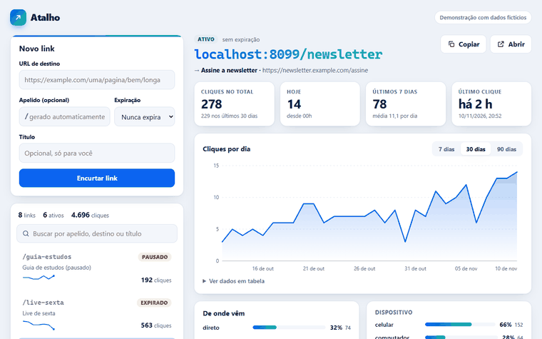
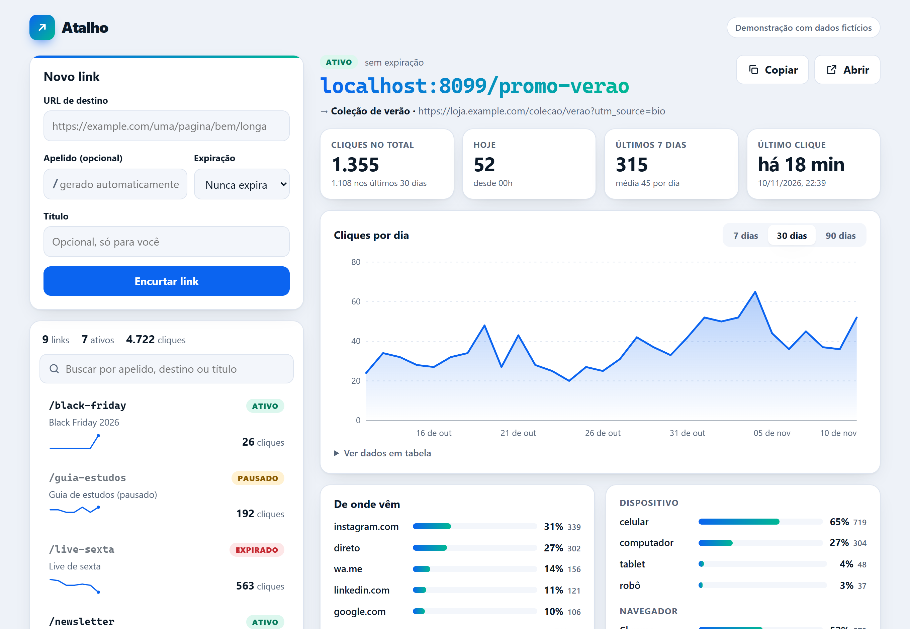
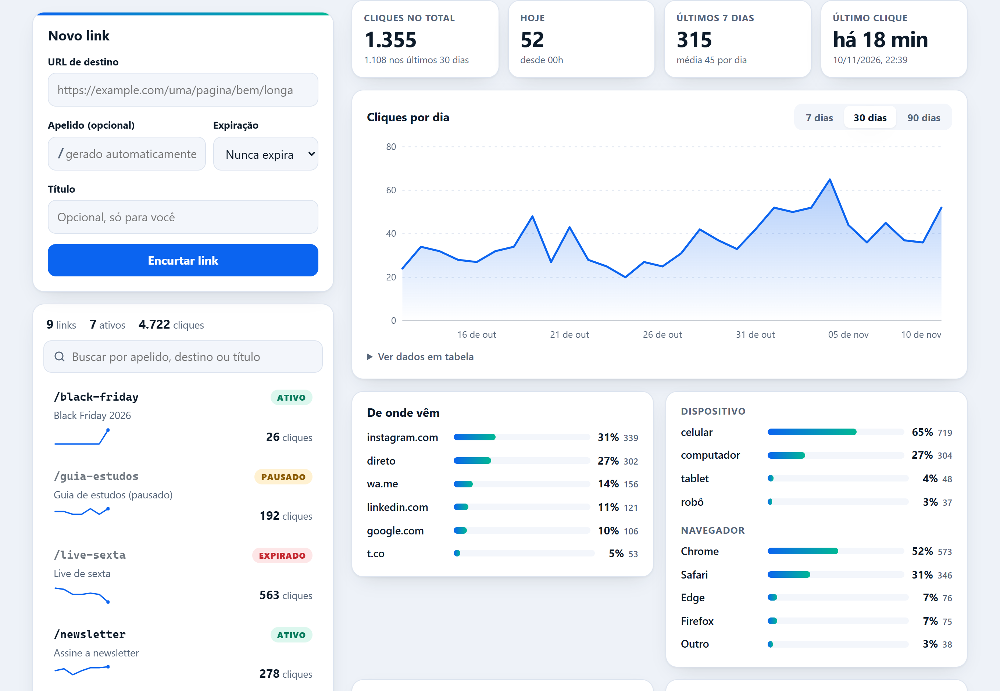
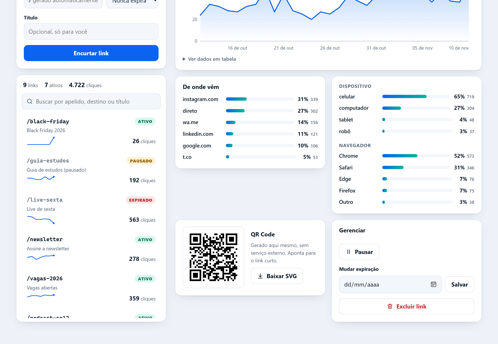
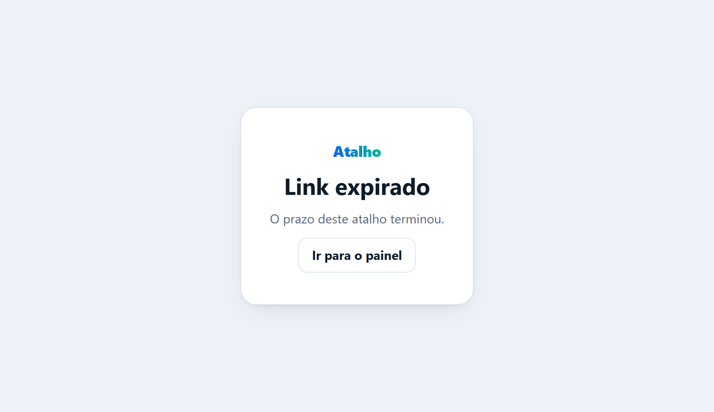
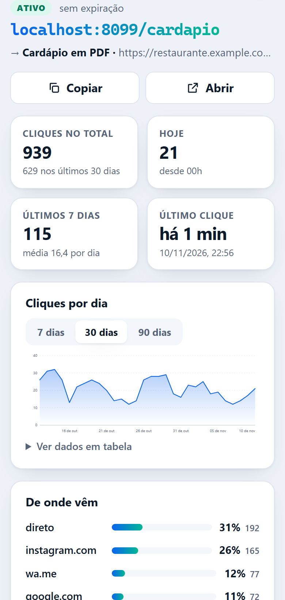
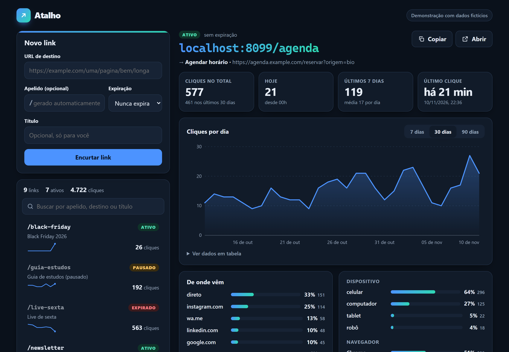

# Atalho: encurtador de links com painel

[](https://github.com/luizrenatodc/encurtador-links/actions/workflows/testes.yml)


Encurtador de URLs com painel web: apelido personalizado, expiração, contagem de cliques por dia com gráfico em SVG, origem e dispositivo de quem clicou, **QR Code gerado em SVG sem biblioteca** e uma API REST. Backend em Node com `node:sqlite`, painel em HTML, CSS e JavaScript puros, **zero dependências**.

> **Projeto de demonstração.** Os links e os cliques que aparecem ao iniciar são **fictícios** (destinos em `example.com`), criados por uma semente de dados. O painel não tem login de usuários: veja "Limites honestos".

## Veja funcionando



| Painel | Estatísticas com o gráfico interativo |
| --- | --- |
|  |  |

| QR Code e gerenciamento | Link expirado (410) |
| --- | --- |
|  |  |

| Celular | Modo escuro |
| --- | --- |
|  |  |

As imagens e o GIF são gerados pelo próprio painel, em um navegador de verdade, por `scripts/telas.mjs`.

## Como rodar

```bash
npm start          # http://localhost:3000
npm test           # 33 testes, sem rede externa
```

Não há `npm install`. Precisa de Node 22.5 ou mais novo (o CI usa o 24). Na primeira execução o banco `dados/links.db` nasce com 8 links e 45 dias de cliques fictícios. Variáveis opcionais:

| Variável | Para quê |
| --- | --- |
| `PORT` | porta (padrão 3000) |
| `BANCO` | caminho do arquivo SQLite |
| `BASE_URL` | domínio público das URLs curtas, por exemplo `https://atalho.exemplo.com` (sem ela, usa o `Host` da requisição) |
| `PAINEL_TOKEN` | se definido, a API exige a chave (`x-api-key` ou `Authorization: Bearer`) e o painel a pede ao abrir |

## API REST

| Método e rota | O que faz |
| --- | --- |
| `GET /:apelido` | redireciona (302) e registra o clique. `410` se expirou ou foi pausado, `404` se não existe |
| `POST /api/links` | cria. Corpo: `url`, `slug?`, `titulo?`, `expira_em?` (ISO) ou `expira_dias?` |
| `GET /api/links?q=` | lista com cliques e minigráfico dos últimos 7 dias |
| `GET /api/links/:apelido` | detalhes de um link |
| `PATCH /api/links/:apelido` | `ativo`, `titulo`, `expira_em` (`null` remove) |
| `DELETE /api/links/:apelido` | exclui o link e o histórico |
| `GET /api/links/:apelido/estatisticas?dias=30` | série diária completa (com zeros), origens, dispositivos, navegadores |
| `GET /api/links/:apelido/qr.svg` | QR Code do link curto |

```bash
curl -s -X POST localhost:3000/api/links -H 'content-type: application/json' \
  -d '{"url":"https://example.com/promocao","slug":"promo","expira_dias":30}'
# {"slug":"promo","curto":"http://localhost:3000/promo","estado":"ativo","cliques":0, ...}
```

## Como funciona

```
src/app.js      rotas, redirecionamento, rate limit, estáticos
src/url.js      validação do destino (URLs perigosas e laços) e do apelido
src/qr.js       gerador de QR Code (ISO 18004) que devolve SVG
src/agente.js   classificação de User-Agent e Referer
src/db.js       esquema SQLite e agrupamento por dia (fuso de São Paulo)
src/semente.js  dados fictícios determinísticos
public/         painel sem build; o gráfico e os minigráficos são SVG montados em JS
test/           33 testes (URL, QR, agente, API de ponta a ponta)
```

### Proteção contra URLs perigosas e laços

O destino é recusado, com mensagem em português, quando:

- o esquema não é `http` ou `https` (`javascript:`, `data:`, `file:` e afins);
- traz usuário e senha embutidos (`https://banco.com@golpe.com`);
- aponta para `localhost`, domínios internos (`.local`, `.internal`...), nomes sem ponto ou **IPs privados, de loopback, link-local e reservados**, em IPv4 e IPv6, inclusive as formas disfarçadas que o parser normaliza (`2130706433`, `0x7f000001`, `127.1`, `::ffff:127.0.0.1`). Isso barra o ataque clássico de acessar `169.254.169.254` (metadados de nuvem);
- aponta para **o próprio encurtador** (host de `BASE_URL` ou do `Host` da requisição), o que criaria um laço;
- é de um **encurtador público conhecido** (`bit.ly`, `tinyurl.com`, `t.co`...), para não esconder o destino real nem encadear redirecionamentos;
- tem espaços, caracteres de controle ou passa de 2048 caracteres.

Apelidos aceitam 3 a 32 caracteres (`a-z`, `0-9`, `-`, `_`), sem diferenciar maiúsculas, e palavras reservadas (`api`, `admin`, `painel`...) ficam de fora. Sem apelido, o servidor sorteia 6 caracteres com `crypto.randomInt`, sem letras ambíguas.

### Decisões

- **Redirecionamento 302, não 301.** O 301 é guardado pelo navegador e os cliques seguintes não chegariam ao servidor. O preço é uma requisição a mais por clique.
- **Dia civil em `America/Sao_Paulo`.** Um clique às 23h30 de Brasília ainda é do mesmo dia, mesmo já sendo o dia seguinte em UTC. A série devolvida pela API vem com os dias sem clique preenchidos com zero.
- **Registrar o clique nunca derruba o redirecionamento.** Se a escrita falhar, o erro vai para o log e a pessoa é redirecionada do mesmo jeito. `HEAD` não conta.
- **Robôs (prévias de chat, `curl`, rastreadores) são contados, mas aparecem como "robô"** na lista de dispositivos, para não esconder o tráfego e também não confundi-lo com gente.
- **QR Code do zero.** `src/qr.js` implementa modo byte, correção de erro nível M, versões 1 a 15, Reed-Solomon sobre GF(256), as 8 máscaras com penalidade e os bits de formato e versão. Os testes conferem a estrutura (localizadores, temporização, tamanho por versão). Além disso, conferi a decodificação das matrizes geradas (versões 1, 2, 3, 6 e 13, inclusive com UTF-8) com um leitor independente, o `QRCodeDetector` do OpenCV, fora do repositório, para não criar dependência.
- **Gráfico em SVG montado no JavaScript**, com escala "bonita" no eixo, dica ao passar o mouse ou tocar, resumo em `aria-label` e uma tabela de dados alternativa em `<details>`.
- **CSP restritiva** (`script-src 'self'`, sem estilo nem script inline) e texto de usuário sempre inserido com `textContent`.

## Limites honestos

- **O painel não tem contas.** Sem `PAINEL_TOKEN`, quem acessa o endereço administra todos os links; com ele, há uma chave única compartilhada. Para vários usuários seria preciso autenticação e dono por link.
- **Não resolve DNS.** Um domínio público que aponte para um IP interno (DNS rebinding) passaria na validação, que olha só o texto da URL. Em produção, convém validar o IP resolvido no momento do redirecionamento ou numa camada de saída controlada.
- **Não consulta bases de phishing ou malware** (como o Safe Browsing). A proteção é estrutural, não de reputação.
- O limite de taxa fica na memória de um processo e usa o IP da conexão; atrás de proxy ele precisa ler o cabeçalho confiável.
- A classificação de User-Agent é por regras simples: serve para uma visão geral, não para análise precisa. Não há geolocalização.
- O QR cobre até a versão 15 (cerca de 400 bytes), mais que suficiente para URLs curtas.
- `node:sqlite` ainda é marcado como experimental no Node; o `npm start` silencia o aviso.

## Autor

Luiz Renato Carvalho, [luizrenato.dev](https://luizrenato.dev). Licença [MIT](LICENSE).
